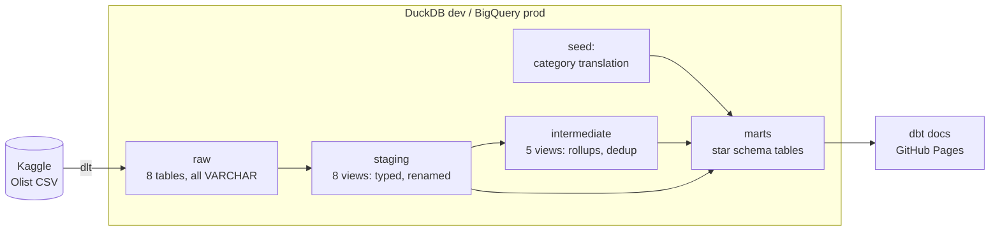
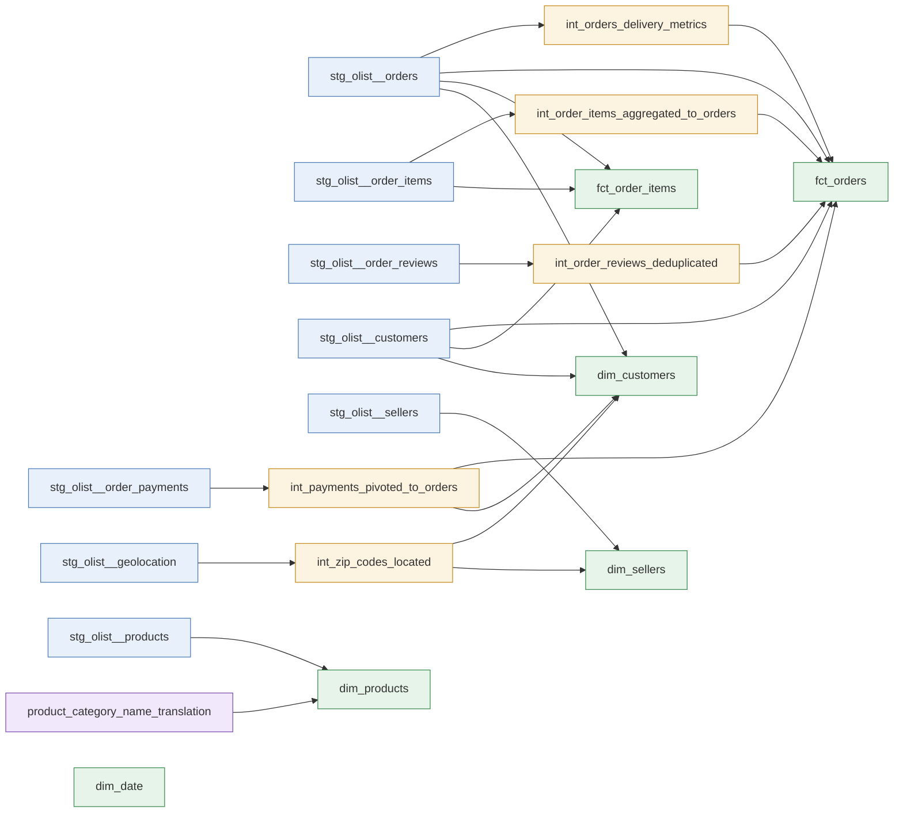
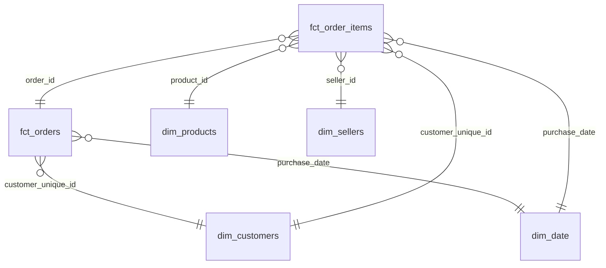

# Olist Analytics — dbt project

[](https://github.com/ShuCiG/olist-analytics-dbt/actions/workflows/ci-cd.yml)
[](https://shucig.github.io/olist-analytics-dbt/)

An end-to-end ELT project on the [Olist Brazilian e-commerce dataset](https://www.kaggle.com/datasets/olistbr/brazilian-ecommerce)
(~100k orders, 2016–2018, 8 related tables). Raw data is loaded with **dlt** into **DuckDB** (local dev) and
**BigQuery** (prod) and modeled with **dbt Core** into a tested star schema. Every pull request is built in CI on
DuckDB and, slim, on BigQuery. Every merge deploys to BigQuery prod and publishes the dbt docs.

**📖 Live dbt docs with lineage graph:** https://shucig.github.io/olist-analytics-dbt/

## Stack

| Layer | Tool |
|---|---|
| Ingestion (EL) | [dlt](https://dlthub.com/) — Kaggle CSV → DuckDB `raw` schema or BigQuery `raw` dataset; order tables arrive in monthly chunks (`merge`, cursor in dlt state) |
| Warehouse | DuckDB (local dev), BigQuery (`prod` / `ci` targets, EU) — same models, identical test results |
| Transformation (T) | dbt Core 1.12 + dbt-duckdb, `dbt_utils`, `dbt_expectations`, `dbt_date` |
| Code quality | sqlfluff (dbt templater) + pre-commit hooks |
| CI/CD | GitHub Actions. PR: `sqlfluff lint` → full `dbt build` on DuckDB + slim CI on BigQuery (`state:modified+ --defer` to prod) in per-run datasets. Merge: dlt → BigQuery, `dbt build --target prod`, docs → GitHub Pages |
| Environment | uv, Python 3.12 |

## Architecture



## Lineage



## Data model



| Model | Grain | Notes |
|---|---|---|
| `fct_orders` | order | item, payment, delivery and review measures |
| `fct_order_items` | order line | reconciles exactly with `fct_orders.order_amount` (singular test) |
| `dim_customers` | **person** (`customer_unique_id`) | Olist issues a new `customer_id` per order. Location comes from the latest order. Includes LTV and repeat flag |
| `dim_products` | product | category translated to English, fallback `unknown` |
| `dim_sellers` | seller | zip-prefix centroid coordinates |
| `dim_date` | day | `dbt_date.get_date_dimension`, 2016–2019 |

## Testing & data quality

**96 data tests** run on every PR (`dbt build`): primary/foreign keys, accepted values, ranges, composite keys, a row-count parity test, 2 singular tests and a custom generic test `is_not_before` (timestamp chronology).

**5 unit tests** (dbt ≥1.8 `unit_tests:`) check transformation logic on hand-made fixtures, independent of the data:
payment pivot by type, delivery lateness rules (date vs timestamp comparison, undelivered orders),
`dim_customers` lifetime value (canceled orders excluded) and location (latest order, deterministic tie-break),
and the incremental filter of `fct_order_items` (`is_incremental()` overridden, `this` as a fixture).

Known defects in the source data are **surfaced as `warn` tests, not hidden**:

| Finding | Handling |
|---|---|
| `review_id` is not unique; 547 orders have several reviews | composite key `(review_id, order_id)`; latest review per order in `int_order_reviews_deduplicated` |
| 278 customer zip prefixes missing from geolocation | `relationships` test, `severity: warn`; dims left-join the centroids |
| 249 orders where amount paid ≠ items + freight (> 1 BRL) | singular test `assert_payments_match_order_amount`, `severity: warn` |
| 2 payments with 0 installments | range test, `severity: warn` |
| 2 product categories have no English translation | `coalesce` fallback to the Portuguese name |
| 1,359 orders handed to the carrier before payment approval (166 before purchase) | `is_not_before`, `severity: warn` |
| 23 orders delivered to the customer before carrier pickup | `is_not_before`, `severity: warn` |

Raw data is loaded as **all-VARCHAR**: zip prefixes keep their leading zeros, and all type casting happens in staging,
where it is visible and tested. Casts use cross-database macros (`dbt.type_timestamp()`, `dbt.datediff`, ...) so
the same models can run on BigQuery.

Mart models have **enforced contracts**: every column is declared with its type, and the build fails if the SQL
returns anything else. Money columns are cast explicitly to `numeric(18, 2)` (`to_money()` macro, per-adapter via `adapter.dispatch`). Shared column
descriptions live in doc blocks (`models/_docs.md`) and are reused across models.

## How to run

Requirements: [uv](https://docs.astral.sh/uv/). Kaggle credentials are not needed.

```bash
uv sync                               # Python 3.12 + dependencies
uv run python ingestion/pipeline.py   # download Olist, load into data/olist.duckdb (schema raw)

cd transform
uv run dbt deps
uv run dbt build                      # seed + 19 models + 96 data tests + 5 unit tests
uv run dbt docs generate && uv run dbt docs serve
```

Simulate data arriving month by month (the dump is static; dlt state remembers the last loaded month):

```bash
uv run python ingestion/pipeline.py --full-refresh --until 2017-06   # orders up to June 2017
uv run python ingestion/pipeline.py --until 2017-07                  # adds July 2017 only
uv run python ingestion/pipeline.py                                  # adds the rest; re-run = no-op
cd transform && uv run dbt source freshness                          # checks raw `_loaded_at`
uv run dbt build        # after each chunk: fct_order_items merges only the new rows
```

BigQuery (needs a GCP project with billing and a service account with *BigQuery Data Editor* + *BigQuery Job User*):

```bash
export GOOGLE_APPLICATION_CREDENTIALS=/path/to/key.json   # Application Default Credentials
export GCP_PROJECT_ID=<your-project>
uv run python ingestion/pipeline.py --destination bigquery
cd transform && uv run dbt build --target prod
```

## Project structure

```
├── ingestion/pipeline.py        # dlt: Kaggle CSV → DuckDB / BigQuery raw, monthly chunks
├── transform/                   # dbt project
│   ├── models/
│   │   ├── staging/olist/       # 1:1 with sources: cast, rename
│   │   ├── intermediate/        # reusable rollups and dedup
│   │   └── marts/               # star schema
│   ├── seeds/                   # category translation
│   ├── tests/                   # singular tests
│   └── macros/                  # generate_schema_name (dev/prod vs CI isolation)
├── .github/workflows/ci-cd.yml  # CI on PR (DuckDB + slim BigQuery), prod deploy + docs on merge
└── docs/                        # PROGRESS.md, DECISIONS.md (architecture decision log)
```

## Development workflow

Feature branch → PR → CI must pass → squash merge → CD.

- **PR:** `sqlfluff lint` + `pyright`, then in parallel a full `dbt build` on DuckDB (fresh dlt ingest) and slim CI on BigQuery:
  only modified models and their children are built, in datasets `ci_pr_<N>_<run_id>_*`; unmodified parents are read
  from prod (`--defer` to the manifest of the last deploy). The datasets are dropped after the run.
- **Merge to `main`:** dlt → BigQuery `raw` (new months only), `dbt source freshness`, `dbt build --target prod`, dbt docs (generated from prod) → GitHub Pages,
  `manifest.json` stored as an artifact for slim CI.
Locally, `uv run pre-commit install` enables the same lint and type check plus hygiene hooks before every commit.
`main` is protected. Design decisions are logged in [docs/DECISIONS.md](docs/DECISIONS.md).

## Roadmap

- [x] **Phase 1 — MVP:** dlt ingestion, staging / intermediate / marts, data tests, CI/CD, docs on Pages
- [x] **Phase 2 — Quality:** dbt unit tests, model contracts, custom generic test, sqlfluff + pre-commit
- [x] **Phase 3 — BigQuery:** prod/CI targets, slim CI (`state:modified+ --defer`) in ephemeral datasets, CD on merge
- [ ] **Phase 4 — Incremental:** month-by-month loads, incremental fact, SCD2 snapshot, source freshness
- [ ] **Phase 5 — Orchestration:** Airflow + Astronomer Cosmos (Docker)
- [ ] **Phase 6 — Dashboard:** Streamlit over marts, dbt exposures
