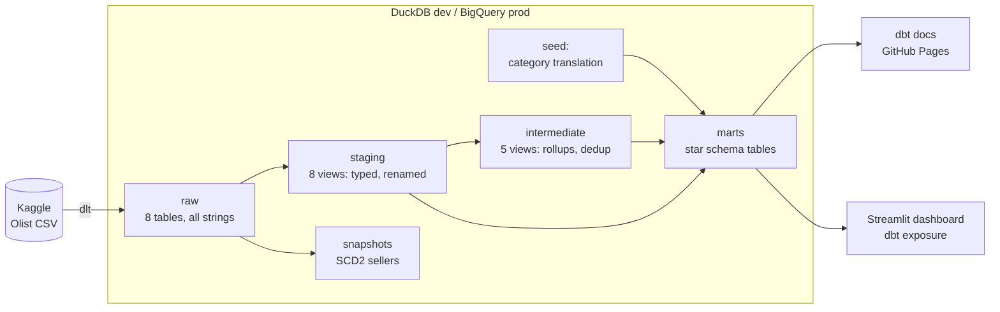
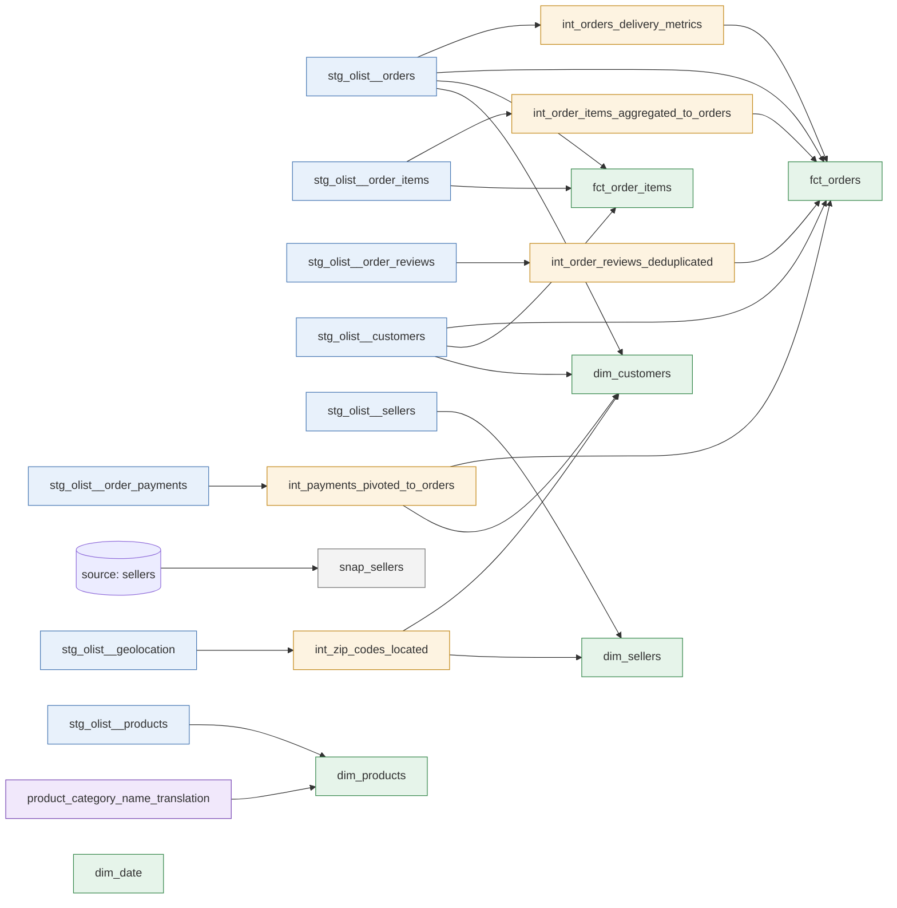
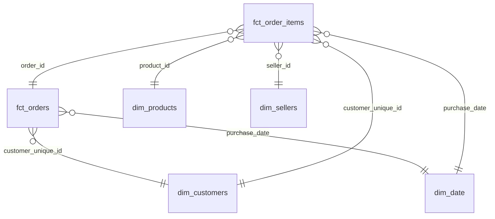
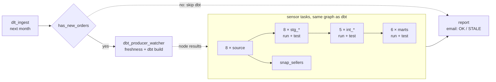

# Olist Analytics — dbt project

[](https://github.com/ShuCiG/olist-analytics-dbt/actions/workflows/ci-cd.yml)
[](https://shucig.github.io/olist-analytics-dbt/)
[](https://olist-analytics-dbt.streamlit.app/)

An end-to-end ELT project on the [Olist Brazilian e-commerce dataset](https://www.kaggle.com/datasets/olistbr/brazilian-ecommerce)
(~100k orders, 2016–2018, 8 related tables). Raw data is loaded with **dlt** into **DuckDB** (local dev) and
**BigQuery** (prod) and modeled with **dbt Core** into a tested star schema. Every pull request is built in CI on
DuckDB and, slim, on BigQuery. Every merge deploys to BigQuery prod and publishes the dbt docs; a Streamlit
dashboard reads the prod marts.

**📖 Live dbt docs with lineage graph:** https://shucig.github.io/olist-analytics-dbt/<br>
**📊 Live dashboard (BigQuery prod):** https://olist-analytics-dbt.streamlit.app/

[](https://olist-analytics-dbt.streamlit.app/)

## Stack

| Layer | Tool |
|---|---|
| Ingestion (EL) | [dlt](https://dlthub.com/) — Kaggle CSV → DuckDB `raw` schema or BigQuery `raw` dataset; order tables arrive in monthly chunks (`merge`, cursor in dlt state) |
| Warehouse | DuckDB (local dev), BigQuery (`prod` / `ci` targets, EU) — same models, identical test results |
| Transformation (T) | dbt Core 1.12 + dbt-duckdb, `dbt_utils`, `dbt_expectations`, `dbt_date` |
| Orchestration | Airflow 3 + [Astronomer Cosmos](https://github.com/astronomer/astronomer-cosmos) in Docker Compose: hourly DAG `dlt ingest → dbt` replaying the dump as a live feed, one month per run (watcher mode: one `dbt build` per run, one Airflow task per dbt node); email alerts (failed / fresh / stale) via SMTP, Mailpit locally |
| Dashboard | Streamlit + Altair on Streamlit Community Cloud, reads BigQuery prod marts with a read-only service account; declared as a dbt exposure |
| Code quality | sqlfluff (dbt templater), pyright, pre-commit hooks |
| CI/CD | GitHub Actions. PR: `sqlfluff lint` + `pyright` + Airflow DAG parse → full `dbt build` on DuckDB + slim CI on BigQuery (`state:modified+ --defer` to prod) in per-run datasets. Merge: dlt → BigQuery, `dbt build --target prod`, docs → GitHub Pages. Any failure → email with the failed step and log excerpt (`ALERT_EMAILS`) |
| Environment | uv, Python 3.12 |

## Architecture



## Lineage



## Data model



| Model | Grain | Notes |
|---|---|---|
| `fct_orders` | order | item, payment, delivery and review measures |
| `fct_order_items` | order line | reconciles exactly with `fct_orders.order_amount` (singular test) |
| `dim_customers` | **person** (`customer_unique_id`) | Olist issues a new `customer_id` per order. Location comes from the latest order. Includes LTV and repeat flag |
| `dim_products` | product | category translated to English, fallback `unknown` |
| `dim_sellers` | seller | zip-prefix centroid coordinates |
| `dim_date` | day | `dbt_date.get_date_dimension`, 2016–2019 |

## Testing & data quality

**102 data tests** run on every PR (`dbt build`): primary/foreign keys, accepted values, ranges, composite keys, a row-count parity test, 2 singular tests and a custom generic test `is_not_before` (timestamp chronology).

**5 unit tests** (dbt ≥1.8 `unit_tests:`) check transformation logic on hand-made fixtures, independent of the data:
payment pivot by type, delivery lateness rules (date vs timestamp comparison, undelivered orders),
`dim_customers` lifetime value (canceled orders excluded) and location (latest order, deterministic tie-break),
and the incremental filter of `fct_order_items` (`is_incremental()` overridden, `this` as a fixture).

Known defects in the source data are **surfaced as `warn` tests, not hidden**:

| Finding | Handling |
|---|---|
| `review_id` is not unique; 547 orders have several reviews | composite key `(review_id, order_id)`; latest review per order in `int_order_reviews_deduplicated` |
| 278 customer zip prefixes missing from geolocation | `relationships` test, `severity: warn`; dims left-join the centroids |
| 249 orders where amount paid ≠ items + freight (> 1 BRL) | singular test `assert_payments_match_order_amount`, `severity: warn` |
| 2 payments with 0 installments | range test, `severity: warn` |
| 2 product categories have no English translation | `coalesce` fallback to the Portuguese name |
| 1,359 orders handed to the carrier before payment approval (166 before purchase) | `is_not_before`, `severity: warn` |
| 23 orders delivered to the customer before carrier pickup | `is_not_before`, `severity: warn` |

Raw data is loaded as **all-VARCHAR**: zip prefixes keep their leading zeros, and all type casting happens in staging,
where it is visible and tested. Casts use cross-database macros (`dbt.type_timestamp()`, `dbt.datediff`, ...) so
the same models can run on BigQuery.

Mart models have **enforced contracts**: every column is declared with its type, and the build fails if the SQL
returns anything else. Money columns are cast explicitly by the `to_money()` macro (per adapter via
`adapter.dispatch`): `numeric(18, 2)` on DuckDB, `round(x, 2)` as `NUMERIC` on BigQuery, which forbids
parameterized types in `CAST`. Shared column descriptions live in doc blocks (`models/_docs.md`) and are
reused across models.

## How to run

Requirements: [uv](https://docs.astral.sh/uv/). Kaggle credentials are not needed.

```bash
uv sync                               # Python 3.12 + dependencies
uv run python ingestion/pipeline.py   # download Olist, load into data/olist.duckdb (schema raw)

cd transform
uv run dbt deps
uv run dbt build                      # seed + 19 models + snapshot + 102 data tests + 5 unit tests
uv run dbt docs generate && uv run dbt docs serve
```

Simulate data arriving month by month (the dump is static; dlt state remembers the last loaded month):

```bash
uv run python ingestion/pipeline.py --full-refresh --until 2017-06   # orders up to June 2017
uv run python ingestion/pipeline.py --until 2017-07                  # adds July 2017 only
uv run python ingestion/pipeline.py --next                           # adds the next month with orders
uv run python ingestion/pipeline.py                                  # adds the rest; re-run = no-op
cd transform && uv run dbt source freshness                          # checks raw `_loaded_at`
uv run dbt build        # after each chunk: fct_order_items merges only the new rows
```

`snap_sellers` keeps SCD2 history of seller location (`check` strategy on zip / city / state, `hard_deletes: new_record`).
Sellers never change in the dump, so prod holds one version each. To see versions locally:

```bash
# change a city and delete a seller in raw, then snapshot
uv run python -c "import duckdb; c = duckdb.connect('data/olist.duckdb'); c.execute(\"update raw.sellers set seller_city = 'campinas' where seller_id = '0015a82c2db000af6aaaf3ae2ecb0532'\"); c.execute(\"delete from raw.sellers where seller_id = '001cca7ae9ae17fb1caed9dfb1094831'\")"
cd transform && uv run dbt snapshot && cd ..
uv run python ingestion/pipeline.py && cd transform && uv run dbt snapshot   # reload restores both
```

| seller | city | dbt_valid_from | dbt_valid_to | dbt_is_deleted |
|---|---|---|---|---|
| 0015a8… | santo andre | 08:28:05 | 08:28:53 | False |
| 0015a8… | campinas | 08:28:53 | 08:29:23 | False |
| 0015a8… | santo andre | 08:29:23 | *null* | False |
| 001cca… | cariacica | 08:28:05 | 08:28:53 | False |
| 001cca… | cariacica | 08:28:53 | 08:29:23 | True |
| 001cca… | cariacica | 08:29:23 | *null* | False |

A reload with no changes adds no versions (dlt metadata columns are not compared).

BigQuery (needs a GCP project with billing and a service account with *BigQuery Data Editor* + *BigQuery Job User*):

```bash
export GOOGLE_APPLICATION_CREDENTIALS=/path/to/key.json   # Application Default Credentials
export GCP_PROJECT_ID=<your-project>
uv run python ingestion/pipeline.py --destination bigquery
cd transform && uv run dbt build --target prod
```

## Dashboard (Streamlit)

`dashboard/` is a Streamlit app over the marts, declared in dbt as the exposure
`olist_dashboard` (visible in the docs lineage graph; `dbt ls --select +exposure:olist_dashboard`
lists the models it depends on). Three pages: sales overview, delivery & reviews, customers & sellers;
a sidebar date filter applies to every query. Live: https://olist-analytics-dbt.streamlit.app/

| Sales overview | Customers & sellers |
|---|---|
|  |  |

```bash
uv run streamlit run dashboard/app.py                                   # DuckDB: data/olist.duckdb
DASHBOARD_BACKEND=bigquery uv run streamlit run dashboard/app.py        # BigQuery prod marts (ADC key)
uv run pytest dashboard                                                 # every page renders (also in CI)
```

The pages send plain SQL that both engines accept, so DuckDB and BigQuery give the same numbers
(checked KPI by KPI). Results are cached for an hour, so BigQuery scans stay small.

Deployed on Streamlit Community Cloud from `main` (entrypoint `dashboard/app.py`; it installs the slim
`dashboard/requirements.txt`, not the dbt/dlt project). It reads prod as service account `dashboard-reader`:
*BigQuery Job User* on the project + *BigQuery Data Viewer* on dataset `marts` only, so it cannot see `raw`
or write anywhere. App secrets:

```toml
DASHBOARD_BACKEND = "bigquery"

[gcp_service_account]   # fields of the service account's JSON key
type = "service_account"
project_id = "..."
# ...
```

## Orchestration (Airflow + Cosmos)

Local Airflow 3 replays the dump as a live feed: an **hourly** DAG run loads the next purchase month with
dlt (`--next`, cursor in dlt state), skips dbt when nothing new arrived (dump used up), else runs the dbt
project as a Cosmos task group in **watcher
mode**: a producer task runs `dbt source freshness` and one `dbt build` for the whole project (dbt threads
run independent nodes in parallel), while one sensor task per node (model run, model tests, seed, snapshot,
source) mirrors that node's result from the producer's log. The Airflow graph still shows every dbt node;
dbt starts and parses the project once per run instead of once per task: **~29 → ~6 min per month on
DuckDB, ~19 → ~6–9 min on BigQuery**.



**Alerts:** at most one email per run — `FAILED` (DAG failure callback: the error and log tail; for dbt, dbt's
summary naming each failed node), `OK: +800 orders, data up to 2017-01, 3 dbt warnings` (summary, dbt totals,
the warn-level tests), or `STALE: no new orders for 25 h` (about once a day). Recipients and the stale threshold
are Airflow Variables; SMTP goes to a local Mailpit inbox (http://localhost:8025) unless a real server is set in
`airflow/.env`. Failed GitHub Actions runs (PR checks, prod deploy) are emailed too: job `notify-failure` sends
the failed jobs, step and log excerpt to repo variable `ALERT_EMAILS`. Emails are styled HTML, and data-test
findings read in business words ("278 customers — zip code missing from the geolocation reference, so maps leave
them out ..."), taken from each warn test's `description` in the dbt yml.

Two DAGs from one factory: `olist_elt_duckdb` (own file `data/airflow.duckdb`, dlt and the dbt producer
serialized by a 1-slot pool) and `olist_elt_bigquery` (isolated `airflow_*` datasets; prod belongs to CD).
Unpause a DAG and the history arrives in ~25 hourly runs; a manual run with `until` catches up at once:

```bash
docker compose -f airflow/docker-compose.yml up -d --build      # UI: http://localhost:8080
docker compose -f airflow/docker-compose.yml exec airflow-scheduler \
  airflow dags trigger olist_elt_duckdb --conf '{"until": "2017-06"}'
```

Details (BigQuery key, params, alerts, reset, re-running a failed month) in [airflow/README.md](airflow/README.md).
CI builds the image and checks that both DAGs parse in watcher mode with only the writers in the DuckDB pool,
dbt gated by `has_new_orders` and the alerts wired.

## Project structure

```
├── ingestion/pipeline.py        # dlt: Kaggle CSV → DuckDB / BigQuery raw, monthly chunks
├── airflow/                     # Docker Compose, Dockerfile, DAG factory (Cosmos)
├── dashboard/                   # Streamlit app over the marts (DuckDB / BigQuery), AppTest smoke test
├── transform/                   # dbt project
│   ├── models/
│   │   ├── staging/olist/       # 1:1 with sources: cast, rename
│   │   ├── intermediate/        # reusable rollups and dedup
│   │   └── marts/               # star schema
│   ├── seeds/                   # category translation
│   ├── snapshots/               # snap_sellers (SCD2, YAML-defined)
│   ├── tests/                   # singular tests + generic test is_not_before
│   └── macros/                  # to_money, generate_schema_name, drop_isolated_datasets (CI / Airflow cleanup)
├── .github/workflows/ci-cd.yml  # CI on PR (DuckDB + slim BigQuery), prod deploy + docs on merge
└── docs/                        # PROGRESS.md, DECISIONS.md (architecture decision log)
```

## Development workflow

Feature branch → PR → CI must pass → squash merge → CD.

- **PR:** `sqlfluff lint` + `pyright` + Airflow DAG parse check (built image), then in parallel a full `dbt build` on DuckDB (fresh dlt ingest) and slim CI on BigQuery:
  only modified models and their children are built, in datasets `ci_pr_<N>_<run_id>_*`; unmodified parents are read
  from prod (`--defer` to the manifest of the last deploy). The datasets are dropped after the run.
- **Merge to `main`:** dlt → BigQuery `raw` (new months only), `dbt source freshness`, `dbt build --target prod`, dbt docs (generated from prod) → GitHub Pages,
  `manifest.json` stored as an artifact for slim CI.

Locally, `uv run pre-commit install` enables the same lint and type check plus hygiene hooks before every commit.
`main` is protected. Design decisions are logged in [docs/DECISIONS.md](docs/DECISIONS.md).

## Roadmap

- [x] **Phase 1 — MVP:** dlt ingestion, staging / intermediate / marts, data tests, CI/CD, docs on Pages
- [x] **Phase 2 — Quality:** dbt unit tests, model contracts, custom generic test, sqlfluff + pre-commit
- [x] **Phase 3 — BigQuery:** prod/CI targets, slim CI (`state:modified+ --defer`) in ephemeral datasets, CD on merge
- [x] **Phase 4 — Incremental:** month-by-month loads, incremental fact, SCD2 snapshot, source freshness
- [x] **Phase 5 — Orchestration:** Airflow 3 + Astronomer Cosmos (Docker), DAG factory for both warehouses, watcher mode
- [x] **Phase 6 — Dashboard:** Streamlit over the marts (DuckDB / BigQuery), dbt exposure, public deploy
- [ ] **Phase 7 — Live feed:** hourly replay of the dump in Airflow, email alerts (done), dashboard on the Airflow-fed marts
