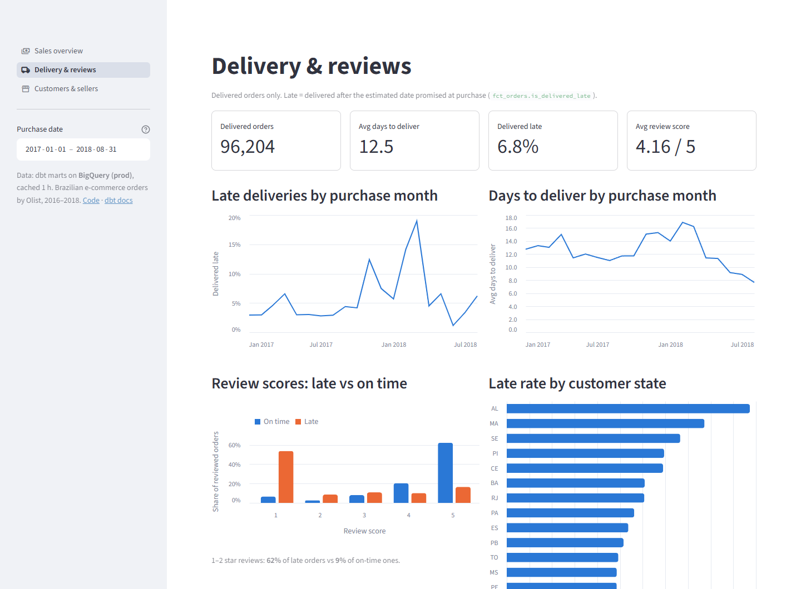
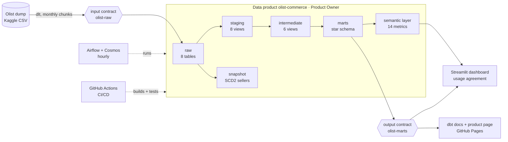
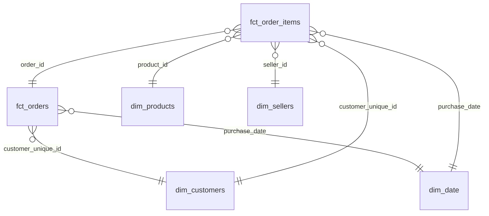
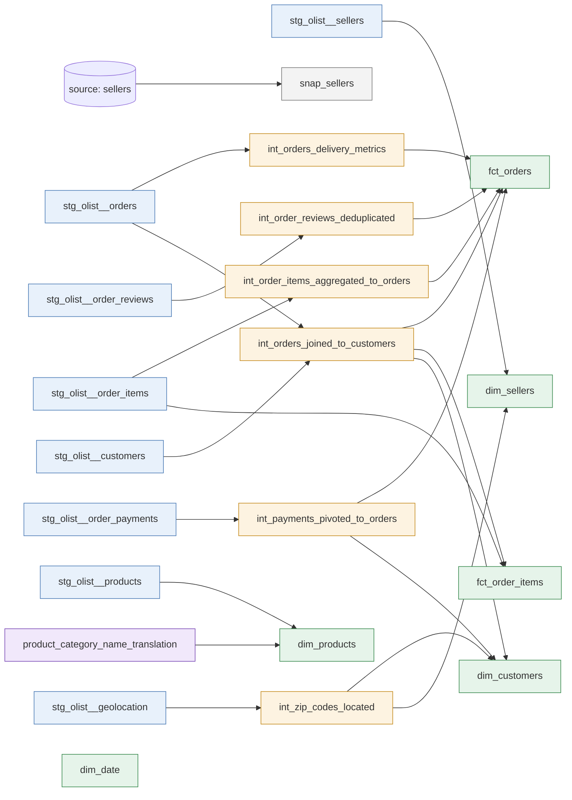
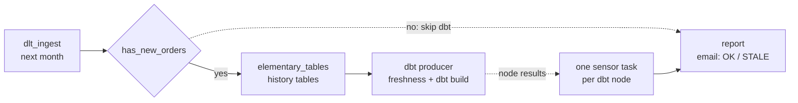
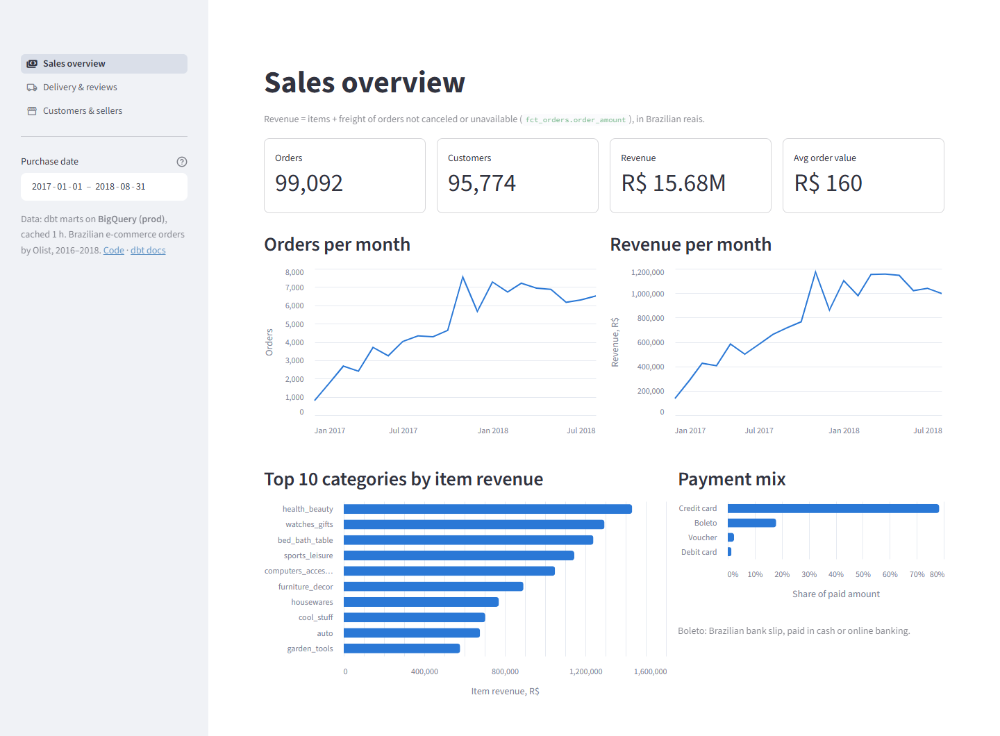
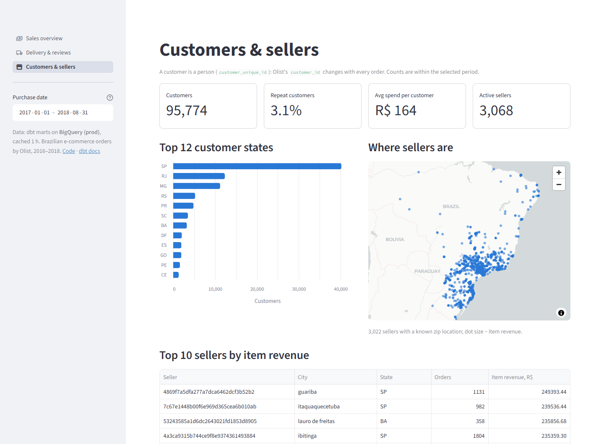

# Olist Analytics — an e-commerce data product on dbt

[](https://github.com/ShuCiG/olist-analytics-dbt/actions/workflows/ci-cd.yml)
[](https://github.com/ShuCiG/olist-analytics-dbt/actions/workflows/databricks.yml)
[](https://github.com/ShuCiG/olist-analytics-dbt/actions/workflows/drift.yml)
[](https://shucig.github.io/olist-analytics-dbt/)
[](https://shucig.github.io/olist-analytics-dbt/data-product/)
[](https://shucig.github.io/olist-analytics-dbt/elementary/)
[](https://olist-analytics-dbt.streamlit.app/)

End-to-end analytics engineering on the [Olist Brazilian e-commerce dataset](https://www.kaggle.com/datasets/olistbr/brazilian-ecommerce)
(~100k orders, 2016–2018, 8 related tables), run as a **data product**: an owner, data contracts on its input and
output, declared consumers, and CI that enforces all of it. **dlt** loads the data, **dbt Core** models it into a
tested star schema and a semantic layer on **DuckDB** (local), **BigQuery** (prod) and **Databricks**, **Airflow + Cosmos** replays
it hourly as a live feed, and a **Streamlit** dashboard reads the result.

| | |
|---|---|
| 📊 **Dashboard** (BigQuery, fed hourly by Airflow) | https://olist-analytics-dbt.streamlit.app/ |
| 📖 **dbt docs** (lineage, columns, tests) | https://shucig.github.io/olist-analytics-dbt/ |
| 📦 **Data product page** (ports, contracts, consumers) | https://shucig.github.io/olist-analytics-dbt/data-product/ |
| 🔭 **Observability report** (test history, anomalies) | https://shucig.github.io/olist-analytics-dbt/elementary/ |

Built with AI pair programming (Claude Code); the architecture, design decisions and code review are mine.
The reasoning behind each choice is in the [decision log](docs/DECISIONS.md).

[](https://olist-analytics-dbt.streamlit.app/)

## Highlights

- **Data product with enforced contracts.** Descriptor in the Open Data Product Standard (owner, input and output
  ports), an ODCS data contract per port, ~370 contract checks on the data in every CI run. The dashboard's usage
  agreement is checked against the SQL it actually sends, and a breaking contract change needs a new major version.
  → [Data product](#data-product)
- **One codebase, three warehouses.** The same dbt models run on DuckDB, BigQuery and Databricks with identical
  mart numbers, through cross-database macros and per-adapter dispatch. → [Data model](#data-model)
- **Team-grade CI/CD.** Every PR: lint, type check, tests, a full build on DuckDB and slim CI on BigQuery
  (`state:modified+ --defer` to prod) in throwaway datasets. Every merge: prod deploy, docs, Airflow image to GHCR.
  No cloud keys in GitHub (Workload Identity Federation); any failure is emailed. → [CI/CD](#cicd)
- **Live feed with alerts.** Airflow 3 + Astronomer Cosmos replays the dump one month per hour; watcher mode and a kept
  dbt partial parse cut a run from ~29 to under 3 minutes; OK / STALE / FAILED emails explain data-quality findings in business words.
  → [Orchestration](#orchestration-and-alerts)
- **Semantic layer.** 14 business metrics defined once in MetricFlow, queried on either warehouse; a test proves the
  dashboard's KPI tiles equal them. → [Semantic layer](#semantic-layer)
- **Data quality at every layer.** 107 data tests, 5 unit tests, enforced model contracts, 158 Python tests; known
  source defects are surfaced as warn tests, not hidden. → [Quality](#data-quality)
- **Data observability.** Elementary keeps the run and test history and checks volume, freshness, column averages
  and source schemas over time; a simulated clock lets the replayed feed catch Black Friday 2017 as an anomaly.
  → [Observability](#data-observability)
- **Governance.** Domain groups with public / protected / private access, a versioned model with a deprecation
  date, and dbt_project_evaluator as a CI gate. → [Governance](#governance)

<details>
<summary><b>What this project demonstrates</b> (skills list)</summary>

- **Analytics engineering:** dbt Core 1.12, dimensional modeling (star schema, SCD2 snapshot), incremental models
  (merge, partitioning, clustering), seeds, macros and `adapter.dispatch`, Jinja, doc blocks, exposures
- **Data quality:** dbt data tests and unit tests, custom generic tests, dbt_expectations, model contracts, source
  freshness, data contracts (ODCS, datacontract-cli), sqlfluff
- **Data observability:** Elementary (volume / freshness / column anomaly detection, schema change monitoring, run and
  test history, `edr report`)
- **Data products and governance:** Open Data Product Standard, data usage agreements, contract versioning and
  breaking-change detection, dbt groups / access / model versions, dbt_project_evaluator, PII classification
- **Semantic layer:** dbt Semantic Layer, MetricFlow (semantic models, simple / ratio metrics, saved queries, time spine)
- **Data engineering:** dlt (incremental loads, state cursor, merge), DuckDB, BigQuery, Databricks (Unity Catalog), ELT, cross-database SQL
- **Orchestration:** Apache Airflow 3, Astronomer Cosmos (watcher mode), Docker Compose, backfills, SLA / stale-data alerting
- **DevOps:** GitHub Actions CI/CD, slim CI with state deferral, ephemeral CI datasets, GHCR images, branch protection,
  pre-commit, pyright, pytest, GitHub Issues + Projects (issue → PR → decision log)
- **Cloud and IaC:** Google Cloud (BigQuery, IAM service accounts with least privilege, Workload Identity Federation, budget, quota, per-query byte caps), Terraform
  (import of existing resources, GCS remote state), Streamlit Community Cloud
- **BI:** Streamlit + Altair dashboard on both warehouses

</details>

## Architecture



| Layer | Tool |
|---|---|
| Ingestion | [dlt](https://dlthub.com/): Kaggle CSV → DuckDB / BigQuery / Databricks `raw`, order tables in monthly chunks (`merge`, cursor in dlt state) |
| Warehouse | DuckDB (local dev), BigQuery (EU): `prod` (CD), `ci` (per-PR datasets), `airflow` (live feed); Databricks Free Edition: catalog `olist` (local), `olist_ci` (weekly CI) |
| Transformation | dbt Core 1.12, `dbt_utils`, `dbt_expectations`, `dbt_date` |
| Data product | ODPS v1.1 descriptor, ODCS v3.1 contracts, `datacontract-cli`, data usage agreements |
| Semantic layer | dbt Semantic Layer / MetricFlow |
| Orchestration | Airflow 3 + Astronomer Cosmos (watcher mode) in Docker Compose; image published to GHCR |
| Dashboard | Streamlit + Altair on Streamlit Community Cloud, read-only service account, dbt exposure |
| Quality & CI | GitHub Actions, sqlfluff, pyright, pytest, pre-commit, dbt_project_evaluator |
| Environment | uv, Python 3.12 |

## Data product

The project is one data product, [`olist-commerce`](data-product/olist-commerce.odps.yaml), described in the
[Open Data Product Standard](https://bitol-io.github.io/open-data-product-standard/): a Product Owner and support
channel, what it is for and its limits, and its ports. Every port with data is bound to a versioned
[ODCS](https://bitol-io.github.io/open-data-contract-standard/) data contract.

| | Port | Contract / definition | What it says |
|---|---|---|---|
| Input | `olist-raw` | [`olist-raw.odcs.yaml`](data-product/contracts/olist-raw.odcs.yaml) | what the product expects from its source: 8 tables, keys, allowed values, freshness |
| Output | `marts` | [`olist-marts.odcs.yaml`](data-product/contracts/olist-marts.odcs.yaml) | what it promises: 5 marts column for column, primary and foreign keys, value and SQL rules, freshness SLA, classification of person-related columns; servers local DuckDB, BigQuery prod, BigQuery live |
| Output | `metrics` | [semantic models](transform/models/marts/_marts__semantic_models.yml) | KPI definitions (no ODCS: it describes tables, not metrics) |
| Consumer | dashboard | [`olist-dashboard.yaml`](data-product/consumers/olist-dashboard.yaml) | data usage agreement: purpose, port, pinned contract version, the 29 columns and 11 metrics it relies on |

**dbt is the implementation, the contract is the promise, and CI holds them together:**

- the input contract is tested right after the ingest (a broken source stops the build before dbt), the output
  contract after `dbt build`: `datacontract ci`, 170 + 201 checks on the data;
- the output contract equals the public dbt models column for column (names, types, keys), so changing a mart
  without changing its contract fails the PR;
- the dashboard's agreement is verified, not trusted: a test records every SQL query the pages send and resolves
  each column with sqlglot, so the agreement always equals what the dashboard really reads;
- a changed contract must raise its version, and a breaking change (`datacontract breaking`: removed column,
  changed type) a new major version, which fails every consumer agreement pinned to the old one until it's renewed.

The [product page](https://shucig.github.io/olist-analytics-dbt/data-product/) is generated from the same YAML and
links an HTML page per contract. Decisions: [D36, D37](docs/DECISIONS.md).

## Data model



| Model | Grain | Notes |
|---|---|---|
| `fct_orders` | order | item, payment, delivery and review measures. Versioned: v2 (latest, table `fct_orders`), v1 deprecated (`fct_orders_v1`) |
| `fct_order_items` | order line | incremental (merge on `_loaded_at`; monthly partitions on BigQuery, liquid clustering on Databricks); reconciles exactly with `fct_orders.order_amount` |
| `dim_customers` | **person** (`customer_unique_id`) | Olist issues a new `customer_id` per order. Location from the latest order; lifetime value and repeat flag |
| `dim_products` | product | category translated to English, fallback `unknown` |
| `dim_sellers` | seller | zip-prefix centroid coordinates; history in snapshot `snap_sellers` (SCD2) |
| `dim_date` | day | `dbt_date` calendar, 2016–2019; time spine of the semantic layer |

Layers: **staging** (8 views, 1:1 with sources: types, names; raw is loaded as all strings so casting is visible
and tested), **intermediate** (6 views: pivots, rollups, dedup, the one orders ⨝ customers join), **marts** (tables
with enforced contracts). Cross-database macros (`dbt.type_timestamp()`, `dbt.datediff`, ...) and `to_money()`
via `adapter.dispatch` (`numeric(18, 2)` on DuckDB and Databricks, `NUMERIC` on BigQuery) keep one codebase for all three engines.

<details>
<summary>Lineage graph</summary>



</details>

## Data quality

| Check | What | Where |
|---|---|---|
| **107 dbt data tests** | keys, relationships, accepted values, ranges, composite keys, row-count parity, chronology (custom generic test `is_not_before`), 2 singular tests | every `dbt build` |
| **5 dbt unit tests** | transformation logic on hand-made fixtures: payment pivot, lateness rules, lifetime value, latest location, the incremental filter | every `dbt build` |
| **Model contracts** | every mart column declared with its type; the build fails if the SQL returns anything else | marts |
| **Data contracts** | 371 checks of the input and output promises on the data | CI, after ingest and build |
| **Source freshness** | `_loaded_at` of the raw tables (warn after a day) | CI, CD, every Airflow run |
| **13 observability tests** | anomalies over time and source schema changes (Elementary, [below](#data-observability)) | every `dbt build` |
| **158 Python tests** | dlt pipeline end to end on a fake dump, alert decisions, dbt summary parser, CI workflow and Terraform guards, supply-chain pins, dashboard pages, KPI = metric, dashboard SQL = usage agreement, data product consistency | CI |

Known defects in the source data are **surfaced as `warn` tests, not hidden**, each with a business description
that the alert emails quote:

<details>
<summary>Source data findings (7 warn tests)</summary>

| Finding | Handling |
|---|---|
| `review_id` is not unique; 547 orders have several reviews | composite key `(review_id, order_id)`; latest review per order in `int_order_reviews_deduplicated` |
| 278 customer zip prefixes missing from geolocation | `relationships` test, `severity: warn`; dims left-join the centroids |
| 249 orders where amount paid ≠ items + freight (> 1 BRL) | singular test `assert_payments_match_order_amount`, `severity: warn` |
| 2 payments with 0 installments | range test, `severity: warn` |
| 2 product categories have no English translation | `coalesce` fallback to the Portuguese name |
| 1,359 orders handed to the carrier before payment approval (166 before purchase) | `is_not_before`, `severity: warn` |
| 23 orders delivered to the customer before carrier pickup | `is_not_before`, `severity: warn` |

</details>

## Data observability

Tests answer "is this build right?"; [Elementary](https://github.com/elementary-data/elementary) adds "is today's data
normal?". Its dbt package stores every run's results and metrics in an `elementary` schema, and its tests compare
each day with the days before it:

| Test | On | Flags |
|---|---|---|
| `volume_anomalies` | `fct_orders`, `fct_order_items` | a day with unusually many or few orders / items |
| `freshness_anomalies` | `fct_orders` | an unusually long gap between orders |
| `column_anomalies` (average) | `fct_orders.paid_amount`, `review_score` | a day whose average paid amount or review score jumps |
| `schema_changes` | the 8 raw sources | columns added, removed or retyped since the previous run |

Each day is compared with the same weekday in the 14 weeks before. All are warn tests with business descriptions,
so findings reach the alert emails like the other warnings. The data is from 2016–2018, so the tests' clock is
the last order in the data, not today; in the Airflow replay it moves forward month by month, as a live feed's
would. Replaying up to November 2017 flags Black Friday (1,176 orders against ~216 on that weekday) and the days
after it. The [report](https://shucig.github.io/olist-analytics-dbt/elementary/) (Elementary's `edr` CLI, built from
prod on every deploy) shows the test history and the metric charts behind each anomaly.

## Governance

Set up the way marts are shared across teams (dbt Mesh), even in one repo:

- **Groups and access:** every intermediate and mart model belongs to a domain group (`orders`, `parties`) owned by the
  Product Owner. Marts are `public` with enforced contracts; intermediate models used inside one group are `private`
  (a `ref` from another group fails at parse time).
- **Model versions:** `fct_orders` v2 renamed a column, a breaking change, so v1 stays available as a projection of
  v2 until its `deprecation_date`; `ref('fct_orders')` resolves to the latest version.
- **[dbt_project_evaluator](https://github.com/dbt-labs/dbt-project-evaluator)** gates every PR: naming, DAG shape
  (fan-out, rejoins), docs and key-test coverage, contracts on public models, exposures on public models only. Its
  first run led to the `int_orders_joined_to_customers` refactor; accepted exceptions are listed with reasons.

## Semantic layer

14 metrics are defined once in [`_marts__semantic_models.yml`](transform/models/marts/_marts__semantic_models.yml)
(MetricFlow): semantic models on `fct_orders` and `dim_customers` with entities, dimensions and measures, simple
metrics with filters, ratio metrics, 2 saved queries, `dim_date` as time spine. MetricFlow writes the SQL for the
current warehouse, joins included.

| Metric | Definition |
|---|---|
| `orders`, `sold_orders` | orders placed; of them, not canceled or unavailable |
| `revenue`, `average_order_value` | items + freight of sold orders, BRL; revenue / sold orders |
| `customers`, `revenue_per_customer` | people who ordered in the period; revenue / them |
| `delivered_orders`, `late_deliveries`, `late_delivery_rate` | delivered orders; of them, after the promised date; the share |
| `avg_days_to_deliver`, `avg_review_score` | purchase → delivery, days; latest review score |
| `new_customers`, `repeat_customers`, `repeat_customer_rate` | people by first order (cohort); of them, who ordered again; the share |

```bash
cd transform && uv run dbt parse
uv run mf query --metrics revenue,average_order_value --group-by metric_time__month --start-time 2018-01-01
```

The dashboard keeps its own SQL (it runs without dbt), and a test compares every KPI tile with `mf query` on the
same data and period. Same numbers on DuckDB and BigQuery: 99,441 orders, R$ 15,735,527.03 revenue, 6.77 % late
deliveries, 3.12 % repeat customers.

## Orchestration and alerts

A local Airflow 3 replays the dump as a live feed. Each **hourly** run loads the next month with dlt, skips the
load and dbt when nothing new arrived (an idle run costs one cached BigQuery query), and otherwise runs the dbt project as a Cosmos task group in **watcher mode**: one
`dbt build` for the whole project, with one Airflow task per dbt node mirroring its result. The graph still shows
every node, but dbt starts once per run instead of once per task: **~29 → ~6 min per month on DuckDB, ~19 → ~6–9 min
on BigQuery**. The replay clock reaches dbt as an env var, not `--vars`, so dbt keeps its partial parse between
runs: a warm DuckDB run **3.4 → 2.75 min**; with the caches on a volume, the first run after an image upgrade too (**6.4 → 3.8 min**). Two DAGs from one factory: DuckDB and BigQuery (own `airflow_*` datasets; prod belongs to CD).



**Alerts:** at most one email per run: `FAILED` (the error and log tail; for dbt, the failed nodes), `OK: +800
orders, data up to 2017-01, 3 dbt warnings`, or `STALE: no new orders for 25 h` (about once a day). Warn-test
findings read in business words ("278 customers — zip code missing from the geolocation reference, so maps leave
them out ..."). Failed GitHub Actions jobs are emailed too, with the failed step and a log excerpt.

The Airflow image is prod-like: code, dbt packages and manifest baked in, labelled with its git commit, published
to GHCR on every merge (deploy and roll back by tag). Details: [airflow/README.md](airflow/README.md).

## CI/CD

| On every pull request | On every merge to `main` |
|---|---|
| sqlfluff, pyright, pytest, terraform fmt / validate / test, dbt_project_evaluator, Airflow DAG parse (built image), contract versioning vs `main` | dlt → BigQuery `raw` (new months only), source freshness |
| full `dbt build` on DuckDB after a fresh ingest, with input / output contract tests, semantic layer validation, dashboard and data product tests | `dbt build --target prod` (Elementary's history tables first, when its models changed) |
| slim CI on BigQuery: only modified models and their children (`state:modified+ --defer` to the prod manifest), in per-run datasets dropped afterwards | dbt docs + data product page + Elementary report → GitHub Pages; manifest kept for slim CI |
| email on any failed job | Airflow image → GHCR; email on any failed job |

Weekly and on demand, a separate workflow loads a few months into Databricks and runs the full build there as a
service principal limited to its own catalog, then drops the run's schemas ([D58](docs/DECISIONS.md)).

Docs-only changes (Markdown outside `transform/`, issue forms) run only the lint, type check and tests:
the builds and the prod deploy skip ([D52](docs/DECISIONS.md)).

`main` is protected; every change starts as an [issue](https://github.com/ShuCiG/olist-analytics-dbt/issues) and
goes through a PR that closes it, tracked on the [roadmap board](https://github.com/users/ShuCiG/projects/2). The same lint, type check and tests run locally as pre-commit hooks.

GitHub Actions holds no GCP keys: jobs exchange their OIDC token for a service account through Workload Identity
Federation. GCP lets only pull requests of this repo use the CI account and only the `prod` environment on `main` use
the prod writer ([D57](docs/DECISIONS.md)).

The GCP side (datasets, service accounts, IAM grants, keyless GitHub access, budget, BigQuery quota) is Terraform in [`infra/`](infra/),
with state in a GCS bucket. It was imported from the hand-made setup without recreating anything; `plan` and `apply`
run with the owner's account, CI checks format, config and policy rules (`terraform test` on mock providers: no table
expiry, read-only grants, least privilege for CI, the dashboard can read what its data usage agreement names). A daily
workflow runs `terraform plan` against live GCP as a read-only account (keyless, `main` only) and emails when the
project drifts from the code ([D60](docs/DECISIONS.md)).

## Dashboard

Three pages over the marts (sales, delivery & reviews, customers & sellers), a shared date filter, and a sidebar
showing how fresh the data is. It runs on DuckDB or BigQuery with the same SQL, and the deployed app reads the
Airflow-fed marts with a service account that can only read `marts` and `airflow_marts`. Declared in dbt as an
exposure, so it appears in the lineage.

| Sales overview | Customers & sellers |
|---|---|
|  |  |

## Quickstart

Needs only [uv](https://docs.astral.sh/uv/); no Kaggle or cloud account.

```bash
uv sync
uv run python ingestion/pipeline.py          # Olist → data/olist.duckdb
cd transform && uv run dbt deps && uv run dbt build && cd ..
uv run streamlit run dashboard/app.py
```

More — month-by-month loads, the SCD2 demo, data contract and metric queries, BigQuery, Airflow:
[docs/RUNNING.md](docs/RUNNING.md).

## Repository layout

```
├── ingestion/pipeline.py        # dlt: Kaggle CSV → DuckDB / BigQuery / Databricks raw, monthly chunks
├── transform/                   # dbt project
│   ├── models/staging/olist/    #   1:1 with sources: types, names
│   ├── models/intermediate/     #   pivots, rollups, dedup
│   ├── models/marts/            #   star schema, exposures, semantic models and metrics
│   ├── snapshots/ seeds/ macros/ tests/
├── data-product/                # ODPS descriptor, ODCS contracts, consumer agreements, checks, product page
├── airflow/                     # Docker Compose, Dockerfile, DAG factory (Cosmos)
├── dashboard/                   # Streamlit app + tests (pages, KPI = metric, SQL = agreement)
├── alerting/                    # alert emails shared by Airflow and CI
├── tests/                       # pytest: pipeline, dbt summary, alert decisions, CI / Terraform / supply-chain guards
├── infra/                       # Terraform: BigQuery datasets, service accounts, IAM, GitHub OIDC (WIF), budget, quota
├── .github/                     # workflows: ci-cd.yml (CI on PRs, CD on merge), databricks.yml (weekly); issue forms, PR template
└── docs/                        # DECISIONS.md (decision log), RUNNING.md, screenshots
```

License: [MIT](LICENSE).

## Next

Planned work is tracked as [issues](https://github.com/ShuCiG/olist-analytics-dbt/issues) on a public [roadmap board](https://github.com/users/ShuCiG/projects/2) (Todo / In progress / Done); PRs close them with `Closes #N`. Open: dropping `fct_orders` v1 after its deprecation date (2026-12-31, #66), and rotating the Databricks CI secret before it expires (2027-04-19, #91).

The history of the project and the reasoning behind each choice: [docs/DECISIONS.md](docs/DECISIONS.md).
